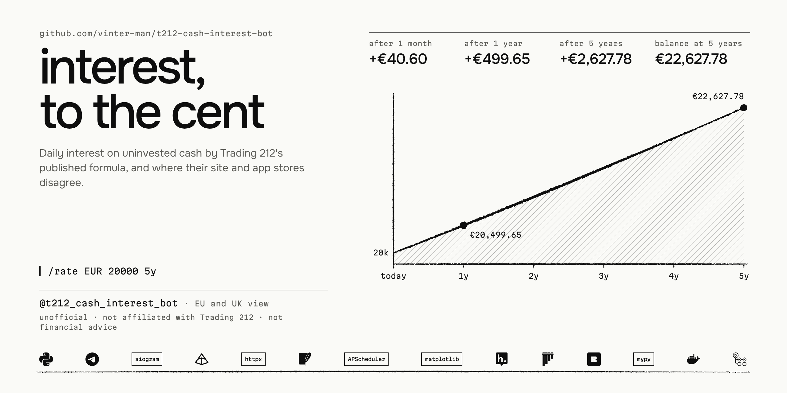
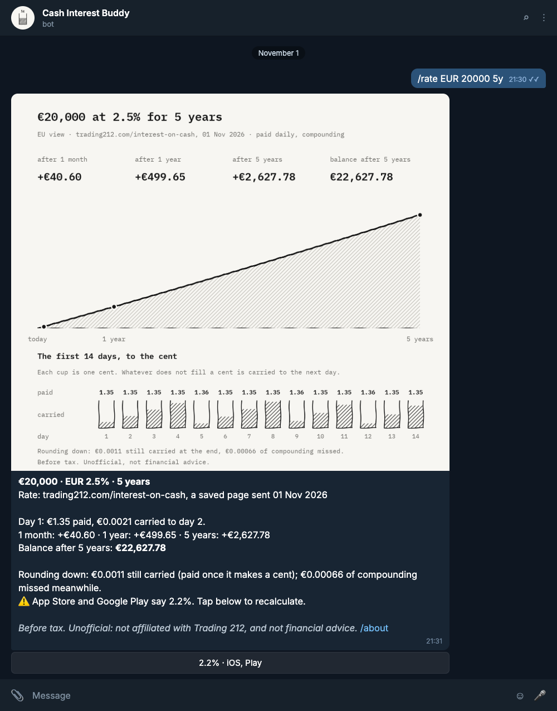
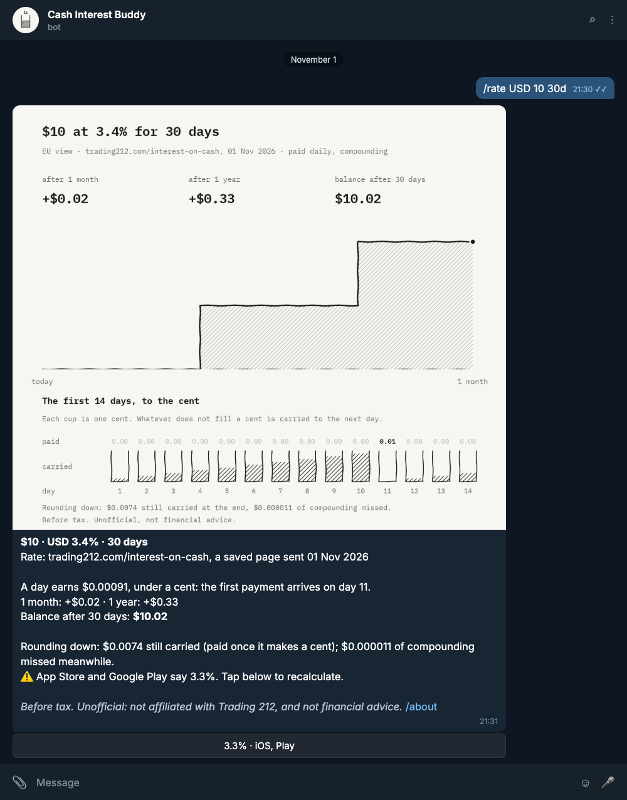
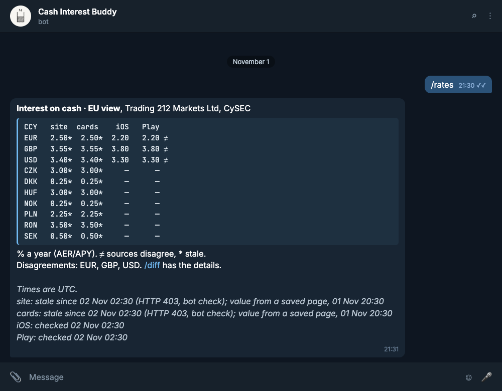
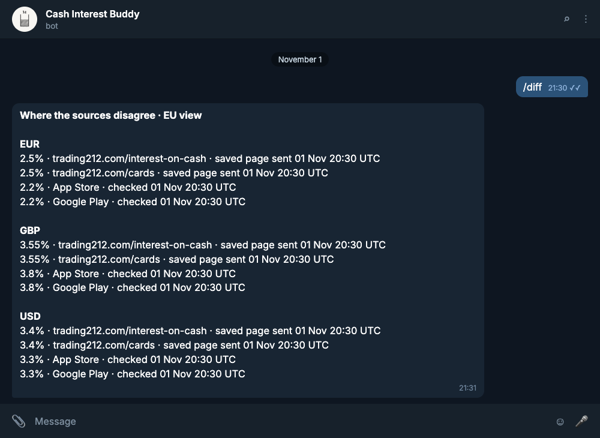
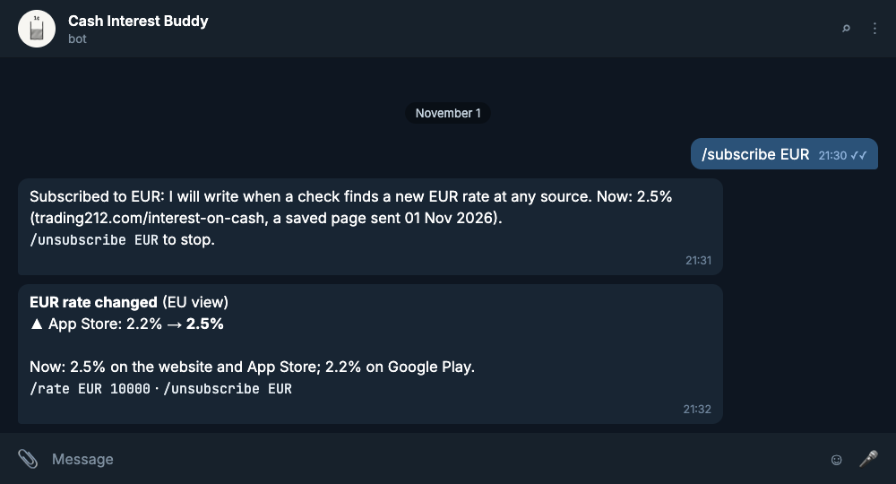
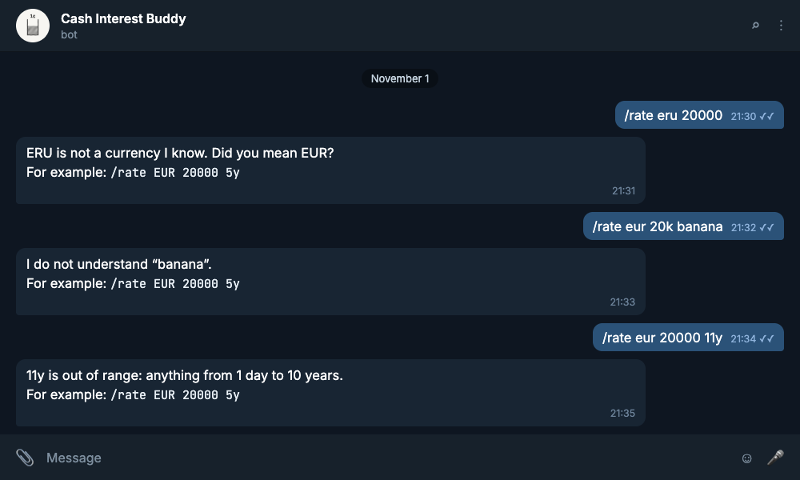

[](https://github.com/vinter-man/t212-cash-interest-bot/actions/workflows/ci.yml)
[](https://github.com/vinter-man/t212-cash-interest-bot/actions/workflows/nightly-live.yml)


[](https://t.me/t212_cash_interest_bot)
[](LICENSE)



> **Unofficial, not financial advice.** Not affiliated with Trading 212. No logos, no logins, no
> API keys: only public pages, each read once every six hours.

## Short description

Trading 212 pays interest on uninvested cash every day. Each payment is rounded down to the cent,
the fraction is carried to the next day, and what was paid earns interest from then on. Their
help centre publishes the formula; this bot runs it, day by day, in `Decimal`:
`/rate EUR 20000 5y` and you get the first day's payment, a month, a year, five years, the
balance at the end, what rounding down costs, and, for a small balance, the day its first cent
arrives.

And it checks the rate itself. On 1 November 2026 the website quoted **2.5%** on euros for EU
clients, while the App Store and Google Play listings said **2.2%** (pounds 3.55% against 3.8%,
dollars 3.4% against 3.3%). On €20,000 over five years that gap is €329.16. The bot reads all
four places every six hours, marks where they disagree, and messages you when any of them
changes.

Try it: [@t212_cash_interest_bot](https://t.me/t212_cash_interest_bot)


---

## Table of contents

* [User guide](#user-guide)
  * [Interest on a balance](#rate)
  * [A balance that earns less than a cent a day](#small)
  * [Every rate from every source](#rates)
  * [Where they disagree](#diff)
  * [When a rate changes](#subscribe)
  * [When you type something odd](#errors)
* [Commands](#commands)
* [The sources](#sources)
* [Tax](#tax)
* [Installation](#installation)
* [Under the hood](#hood)
* [Contact](#contact)

---
---

## <a name="user-guide"></a> User guide

### <a name="rate"></a> Interest on a balance

A currency, an amount, and a period if you like (a year by default): `/rate EUR 20000 5y`. The
`/rate` is optional, so `EUR 20000 5y` works too.



The chart reads top to bottom: what the balance has earned after a month, a year and the whole
period; how the earnings grow; and the first two weeks to the cent, each day drawn as a one-cent
cup. A day pays out the whole cents and keeps the rest of the cup for tomorrow. The caption
repeats every number as text. When another source quotes a different rate, a button under the
answer recalculates at that one.

> :godmode: The help centre's rule, as code (`calc/interest.py`):
>
> ```
> daily rate = (1 + AER)^(1/365.25) − 1
> each day:  accrued = balance × daily rate + carried      paid    = accrued, rounded down to 0.01
>            carried = accrued − paid                      balance = balance + paid
> ```
>
> No float touches money. The daily rate is worked out to 50 significant digits and each day's
> interest kept to 18 decimal places, which makes every sum in the simulation exact even in
> Python's default 28-digit context: `paid + carried == accrued` on every day of ten years, and
> the day-by-day result lands on the same cent as a separately written loop over integer cents.
> A year is a calendar year from today, so one with a 29 February in it pays slightly more than
> the AER and the others slightly less, which is what 365.25 is for: the AER holds exactly over
> four years, and a test checks that it does.
>
> One detail I did not expect: the help centre's worked example ($1,000 at 5%) carries 0.00359,
> 0.00718 and 0.00077 over three days. Its payments, 0.13, 0.13 and 0.14, match the exact
> arithmetic, but those carries come from a daily figure rounded to 0.13359 first; the exact
> ones are 0.0035891, 0.0071956 and 0.0008194. The bot keeps the exact fraction, and the tests
> compare the payments, which is what actually reaches a balance.

"Rounding down" in the caption is two numbers. The fraction still carried at the end isn't lost,
only late: it is paid once it makes a cent. The compounding that fraction missed while it waited
is lost for good, and it is tiny: €0.00066 over five years on €20,000.

### <a name="small"></a> A balance that earns less than a cent a day

$10 at 3.4% earns $0.00092 a day. Nothing is paid until the carried fractions add up to a cent,
on day 11; the cups show them filling up.



> :suspect: The first payment day is worked out exactly rather than by simulation: the balance
> doesn't move until the first payment, so it is the first `n` with `n × daily interest ≥ 0.01`.
> That answers even for ten cents at 0.25%, whose first cent comes on day 14,629, forty years
> out. A property test checks the closed form against the simulation for hundreds of random
> balances and rates.

### <a name="rates"></a> Every rate from every source

`/rates` is the whole table for your region: each currency, each source, `≠` where they
disagree, `*` where a value is stale, and when each source was last checked and how that went.



### <a name="diff"></a> Where they disagree

`/diff` is the same table cut down to the currencies the sources disagree on, one line per
source, with the time of its last check.



### <a name="subscribe"></a> When a rate changes

`/subscribe EUR` and the bot writes when any source changes its euro rate, with what all four
say at that moment. `/subscribe` on its own lists your subscriptions; `/unsubscribe EUR` stops one.



> :shipit: No false alarms, by construction (`poller.py`). A check that fails (blocked, timed
> out, a parser that finds nothing) is recorded and nothing else happens: the last good value
> stays on show, marked "stale since", and nobody is notified. A change is only a successful
> check that disagrees with the previous *successful* check of the same source, so a failure in
> between can neither hide a change nor invent one. A currency appearing in a listing or
> dropping out of it isn't a change either, and a parser that reads 25% somewhere fails the whole
> page instead of reporting one bad row. A test plays exactly that sequence (value, outage,
> same value, unreadable page, new value) and expects one alert.

### <a name="errors"></a> When you type something odd

The parser is a tokenizer: the words can come in any order and any case. An amount can be `20k`,
`20 000`, `20,000.50`, `20.000,50`, `€20000`, `£1.5k` or `2m`, a period `30d`, `2w`, `6m`,
`5y` or `5 years`. Whatever it doesn't recognise is named back to you with an example, and two
amounts, two currencies or two periods are an error rather than a guess.



> :suspect: `6m` is six months after an amount and six million when it is the only number, so
> `/rate EUR 20000 6m` and `/rate EUR 2m` both mean what they say. A separator before exactly
> three digits groups thousands, unless what comes before it can't lead a grouped number:
> `20.000` is twenty thousand, `0.001` is a tenth of a cent and refused, `1234.567` is refused
> too. `kr` could be three currencies, so it asks. The buttons under an answer are validated
> again when they come back, like anything typed: Telegram doesn't check callback data
> against the message it came from. `bot/parsing.py`.

---
---

## <a name="commands"></a> Commands

| Command | What it does |
|---|---|
| `/rate <CCY> <amount> [<period>]` | interest day by day, as a chart: `/rate EUR 20000 5y` |
| `/rates` | every rate from every source, disagreements marked |
| `/diff` | only the currencies the sources disagree on, with each source's last check |
| `/subscribe <CCY>` | a message when any source changes that currency's rate |
| `/unsubscribe <CCY>` | stop those messages |
| `/help`, `/about` | how to ask; the formula, the sources, tax and the fine print |

---
---

## <a name="sources"></a> The sources

| Source | What is read | Region |
|---|---|---|
| [trading212.com/interest-on-cash](https://www.trading212.com/interest-on-cash) | the page's `__NEXT_DATA__` JSON, not its markup | every company's rates are in it: `T212CY` (EU, CySEC), `AVUSUK` (UK, FCA) |
| [trading212.com/cards](https://www.trading212.com/cards) | its own copy of the same JSON | the same |
| [App Store](https://apps.apple.com/gb/app/trading-212/id566325832) | Apple's public lookup API, the line about "interest on your uninvested cash" | storefront `cy` for EU, `gb` for UK |
| [Google Play](https://play.google.com/store/apps/details?id=com.avuscapital.trading212&hl=en) | the listing's description block, or the same text in the page's data | `gl=CY` for EU, `gl=GB` for UK |

Rates depend on which Trading 212 company serves you, and that depends on your country. Every
rate is stored with its source and region, and the bot follows one region: EU by default,
`REGION=UK` for the UK view. Each source is asked once per cycle with an honest User-Agent and a
20-second timeout. Network errors and 5xx are retried twice (after 2 s and 4 s); a 403 or 429 is
an answer, so that source is left alone until the next cycle.

> :rage1: trading212.com answers anything that isn't a browser with a Cloudflare bot check, even
> for `/robots.txt`, and from a home connection as well as from a server. The bot doesn't
> pretend to be a browser. It still asks every six hours (so the day the site lets it in,
> nothing needs changing) and records "HTTP 403, bot check". It keeps showing the last value it
> has, marked stale, and the owner can send it the page saved from their own browser: it reads
> the same JSON from the file and records it as "a page saved in a browser". The website parsers
> are tested on exactly such saved pages ([tests/fixtures](tests/fixtures)), and the nightly live
> check skips the website when it is challenged rather than reporting a broken parser.
>
> The stores answer normally. Their listings are written by hand, separately from the website,
> which is why they are the copy most likely to drift: on 1 November 2026 all three currencies
> they name disagreed with the website for the EU view, and two of the three for the UK view.

---
---

## <a name="tax"></a> Tax

The bot calculates interest before tax. Trading 212 withholds tax only for residents of Cyprus
(17% special defence contribution and 2.65% GHS); everyone else is paid gross and declares it at
home. `/about` says the same.

---
---

## <a name="installation"></a> Installation

You need a bot token from [@BotFather](https://t.me/BotFather) and
[uv](https://docs.astral.sh/uv/), which brings the right Python with it.

```bash
git clone https://github.com/vinter-man/t212-cash-interest-bot && cd t212-cash-interest-bot
cp .env.example .env          # BOT_TOKEN; REGION=EU or UK; OWNER_ID if you want to send saved pages
uv sync
uv run python -m cash_interest
```

### Docker

```bash
cp .env.example .env
docker compose up -d --build
docker compose logs -f
```

Long polling, so no ports are published. Read-only root filesystem, no capabilities, a non-root
user, and a healthcheck on a heartbeat file that a background task touches each minute after a
successful `getMe`, so "healthy" means the process is alive and can reach Telegram. The SQLite
file (every check of every source, and the subscriptions) lives in the `data` volume.

### On a VPS

[`deploy/README.md`](deploy/README.md): a push to `main` runs the CI gate, and only then SSHes in
with a key that can run one script. That script deploys the tested commit, waits for the
healthcheck and rolls back if the new version doesn't come up. A restart doesn't poll early: the
next poll is six hours after the last one in the database.

---
---

## <a name="hood"></a> Under the hood

```
sources ──→ poller ──→ store (SQLite) ──→ board ──→ replies + chart ──→ Telegram
4 parsers   6-hourly    every check        side by side   /rate /rates /diff
            changes ──→ subscribers
```

| Module | What is in it |
|---|---|
| `calc/` | the arithmetic and nothing else: no I/O, no clock, `Decimal` only |
| `sources/` | one parser per source behind `fetch() -> list[Rate(ccy, apy, source, region, fetched_at)]`, and the one polite GET they share |
| `store/` | aiosqlite: every check whatever its outcome, the rates of the successful ones, subscriptions |
| `poller.py` | one cycle over the sources; what counts as a change |
| `board.py` | the sources side by side: disagreements, staleness, which rate to calculate with |
| `answer.py`, `charts.py` | a `/rate` answer worked out once, and drawn with matplotlib in the house style |
| `bot/` | aiogram handlers, input parsing, reply texts, buttons; the app with APScheduler and the heartbeat |
| `scripts/` | the rate snapshot for CI, the fixture trimmer, the screenshot exporter |

```bash
uv sync
uv run pytest -q --cov        # no network, no Telegram
uv run ruff check . && uv run ruff format --check .
uv run mypy                   # --strict, over the package, the scripts and the tests
uv run pytest -m live         # the real sources, as the nightly job runs it
```

The tests are the part of this I care most about:

- **The arithmetic** (`test_calc.py`): the help centre's example, $10 at 5% paid first on day 8,
  zero balance, 0%, a leap year against a plain one, four years that compound to exactly the AER,
  ten years with no drift. Coverage of `calc/` is 100%, and CI fails below that.
- **Properties** (`test_calc_properties.py`, hypothesis): for any balance, rate and length,
  paid plus carried is what accrued, every payment is whole cents and never negative, the balance
  is the principal plus every payment, rounding only ever delays money, and the closed-form first
  payment day agrees with the simulation.
- **Parsers on saved pages** (`test_sources_*.py`): the real pages from the day they disagreed,
  both regions, and every way a page can break: no JSON, cut off in the middle, a renamed key, a
  missing company, a rate of 25%, a reworded listing, a moved description block, the Cloudflare
  pages. The HTTP policy has its own tests: what is retried, how long it waits, what is not.
- **The bot through the real dispatcher** (`test_bot.py`, `test_app.py`): a fake Bot API session
  records every call, so filters, callback data, parsing, the chart and the database run as in
  production, including what Telegram really does: a forged button, a second tap ("message is
  not modified"), a chart that fails to draw, flood control, a user who blocked the bot.
- **The program end to end** (`tests/e2e`): `python -m cash_interest` started as a separate
  process against a small fake Telegram server, as Docker starts it: commands in, a PNG uploaded,
  a button pressed, a subscription in the database, and a clean exit on SIGTERM.
- **Live** (`tests/live`, nightly): the parsers against the real pages, failing on a page that
  answers but yields nothing or a rate outside 0–15%. A failure opens an issue with a snapshot
  of what every source says; [Check rates now](https://github.com/vinter-man/t212-cash-interest-bot/actions/workflows/check-rates.yml)
  is a button that prints that table into the run's summary.

---
---

## <a name="contact"></a> Contact

GitHub: [vinter-man](https://github.com/vinter-man)

Bot: [@t212_cash_interest_bot](https://t.me/t212_cash_interest_bot)

License: [MIT](LICENSE). Unofficial, not affiliated with Trading 212, not financial advice.
